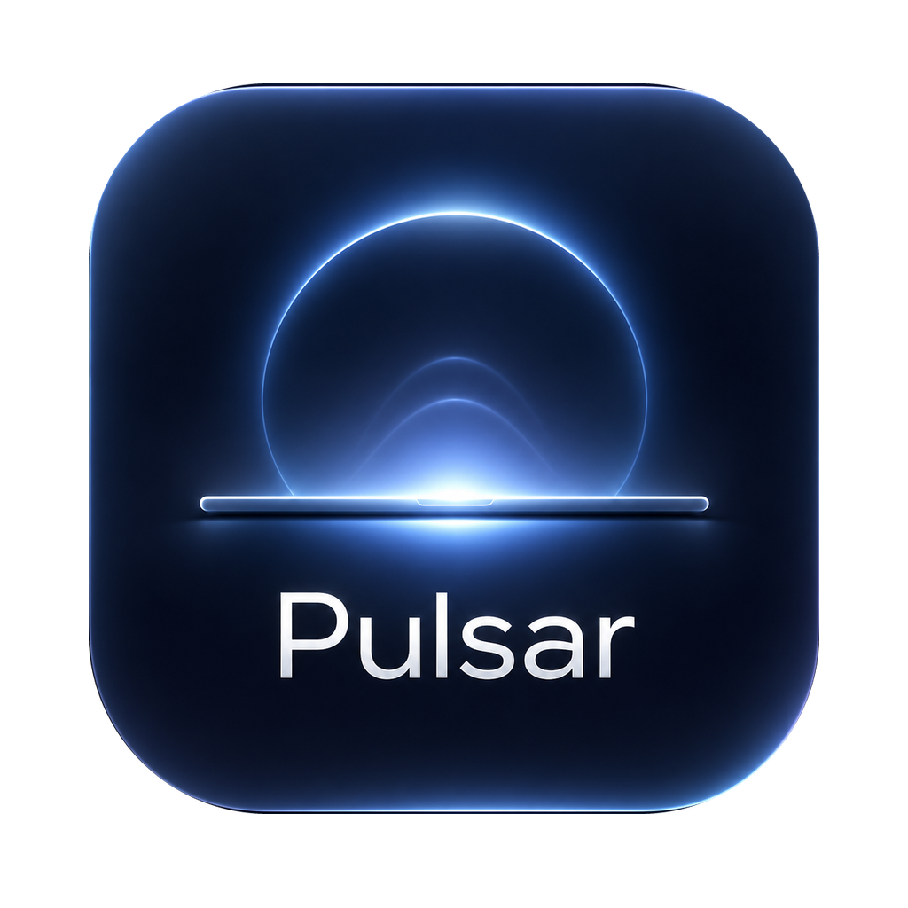

<p align="center"></p>

<h1 align="center">Pulsar</h1>

<p align="center">A menu-bar app that brings the glowing logo on the back of the M5 Pro / M5 Max MacBook Pro to life.</p>

---

## Requirements
- A **MacBook Pro with the PROLED display and the illuminated logo** (M5 Pro or M5 Max). On other Macs the app opens and shows that no logo was found.
- macOS 14.2 or later. Developed on macOS 27.
- To build: Xcode or the Command Line Tools (Swift 5.10+).

## Effects

| Effect | What it does |
|---|---|
| **Glow** | Steady light at your chosen brightness |
| **Breathe** | Slow swell and fade, with adjustable pace |
| **Pulse** | Brisk, even throb, with adjustable tempo |
| **Heart** | Lub-dub heartbeat from 45 to 140 BPM |
| **Beat** | Flashes on the kick drum of whatever your Mac is playing, with punch, sensitivity and strobe settings |
| **Charge** | Logo brightness matches your battery percentage and ripples while charging |
| **Morse** | Flashes a message you type in Morse code, with adjustable speed and loop |
| **Agents** | Shows the state of your AI coding agent: calm when idle, pulsing while it works, blinking when it needs you |

## Controls
- **Click** the menu-bar icon to open the panel.
- **⌥-click** or **right-click** the icon to turn the logo on or off. **⌃⌥⌘L** does the same from anywhere.
- **Brightness** slider with 25 / 50 / 75 / 100 presets.
- **Lit with lid closed**: keeps the Mac awake with the lid shut so the logo stays on. It runs on AC power by default (battery is optional) and stops after 30 minutes, below 20% battery, or when the Mac gets hot. A watchdog process restores normal lid-sleep if Pulsar crashes.
- **Full brightness anywhere**: removes macOS's room-light limit on the logo. It asks for your admin password, and you can undo it at any time.
- **Battery saver**: sends fewer hardware updates when unplugged.
- **Open at login**.

### Agent integration
**Connect** in the Agents panel adds hooks to Claude Code's `~/.claude/settings.json` and backs the file up first. Any other tool or script can drive the logo through the URL scheme:

```bash
open -g 'pulsar://agent?state=working'   # idle | working | alert | done | off
open -g 'pulsar://effect?name=music'     # steady | breathe | pulse | heartbeat | music | battery | morse | agents
open -g 'pulsar://toggle'
open -g 'pulsar://panel'
```

## Build and install

```bash
git clone https://github.com/<you>/pulsar.git && cd pulsar
./build.sh --install        # build, sign, copy to /Applications and launch
```

`./build.sh --run` builds and launches the app from the repo folder instead.

**Signing.** macOS remembers permissions such as system-audio access per signing identity. `build.sh` uses the best identity available:
1. A **Developer ID Application** certificate, if you have an Apple Developer account. This one is required for `--release`.
2. **Pulsar Local Signing**, a self-signed certificate. Create it once with `tools/make_local_cert.sh` so permissions survive rebuilds.
3. Ad-hoc. This works, but macOS asks for permissions again after every rebuild.

**Release (notarized, ready to share).** Save your notarization credentials once:

```bash
xcrun notarytool store-credentials pulsar --apple-id <you@example.com> --team-id <TEAMID>
```

Then run:

```bash
./build.sh --release        # → dist/Pulsar.zip, signed, notarized and stapled
```

## How it works
macOS's `corebrightnessd` drives the logo from the **display's** brightness. A curve called `LEPWMBrightnessNitsMapping` maps display nits to logo nits. Pulsar does three things:

1. Sets `LEBacklightMode = 2`, which puts the logo under manual control (`Sources/Pulsar/LogoLight.swift`).
2. Replaces the curve with a flat line at the target logo brightness.
3. Moves the display brightness by ±0.002 once per update (invisible) so `corebrightnessd` re-evaluates the curve. Two changes per update would start overlapping fades that fight, so it's always one.

On quit, on SIGTERM, or after a crash (on the next launch), Pulsar restores the original curve and mode.

`corebrightnessd` smooths every change over roughly half a second. Flash effects therefore rest at a mid-level glow and hold each peak long enough to climb, because a short flash that starts from dark barely registers.

**Beat detection** (`Sources/Pulsar/BeatEngine.swift`) taps system audio with a Core Audio process tap and works in these steps:
1. A 40–120 Hz band-pass isolates the kick drum.
2. It measures the rise in log energy every 10 ms.
3. An adaptive threshold (median + k·MAD over the last second) decides what counts as a hit.
4. A refractory period based on the current tempo stops double triggers.

`tools/beat-harness` is an offline test bench for the detector:

```bash
cd tools/beat-harness
python3 -m venv .venv && .venv/bin/pip install numpy scipy
.venv/bin/python harness.py --synthetic          # synthetic track with known kick times
.venv/bin/python harness.py ~/Music/song.m4a     # any audio file
```

**Measuring the logo:** the real duty cycle is `high-period / (high-period + low-period)` on `IODeviceTree:/arm-io/pwm1/bklb-backlight`. The PWM period varies, so `high-period` on its own is misleading.

## Caveats
- Pulsar relies on **private macOS frameworks** (CoreBrightness, DisplayServices). A macOS update can break it.
- It isn't sandboxed and can't ship on the Mac App Store.
- "Lit with lid closed" keeps your Mac awake. Don't put it in a bag.

## Project layout

| Path | What's there |
|---|---|
| `Sources/Pulsar/LogoLight.swift` | Logo hardware driver |
| `Sources/Pulsar/LightEngine.swift` | Effects, render loop, settings |
| `Sources/Pulsar/BeatEngine.swift`, `AudioTap.swift` | System-audio capture and kick detection |
| `Sources/Pulsar/Power.swift` | Lid-closed mode, watchdog, battery info, brightness-limit toggle |
| `Sources/Pulsar/PanelView.swift`, `PulsarApp.swift` | Menu-bar item and panel UI |
| `Sources/Pulsar/System.swift` | Global hotkey, login item, agent hook installer |
| `Assets/` | App icon (`tools/make_icon.py` builds `icon.png` from `icon-source.png`) |
| `tools/` | Beat test bench, icon builder, local signing-certificate helper |

## License
[MIT](LICENSE)
